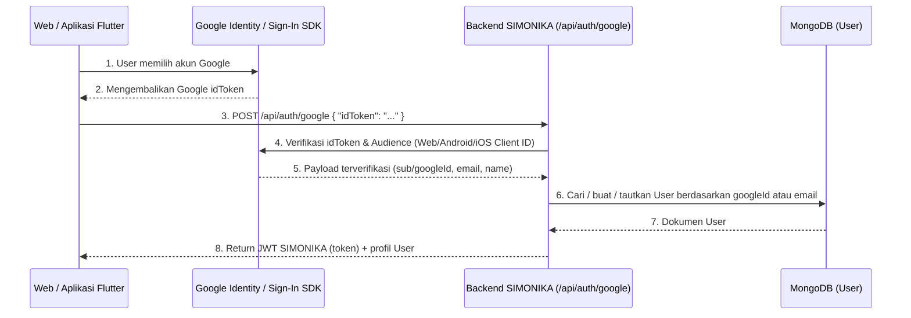

# Panduan Integrasi Google OAuth SIMONIKA (Web & Mobile Flutter)

Dokumen ini menjelaskan cara menyiapkan **Google OAuth** untuk backend Next.js SIMONIKA serta cara mengintegrasikannya ke aplikasi **Mobile Flutter** (Android & iOS) agar berbagi akun yang sama dengan Web Dashboard.

---

## 1. Arsitektur Autentikasi Google di SIMONIKA



Karena semua Client ID (Web, Android, iOS) dibuat dalam **1 Project Google Cloud yang sama**, nilai `sub` (`googleId`) dan `email` user dijamin sama. User yang login via Web maupun aplikasi Flutter otomatis masuk ke akun SIMONIKA yang sama.

---

## 2. Persiapan Kredensial di Google Cloud Console

1. Buka [Google Cloud Console](https://console.cloud.google.com/) dan pilih/buat 1 Project untuk SIMONIKA.
2. Buka **APIs & Services > OAuth consent screen**:
   - Pilih **External**, isi nama aplikasi (`SIMONIKA`), email support, dan simpan.
   - Jika status aplikasi masih *Testing*, daftarkan email yang akan digunakan uji coba pada bagian **Test users**.
3. Buka **APIs & Services > Credentials > + Create Credentials > OAuth client ID**, lalu buat Client ID berikut di dalam project yang sama:

### A. Web Application Client ID (Wajib untuk Web & `serverClientId` Flutter)
- **Application type:** `Web application`
- **Authorized JavaScript origins:**
  - `http://localhost:3000`
  - Domain produksi backend/web Anda (contoh: `https://simonika.id`)
- Simpan nilai Client ID-nya (misal: `111111-web.apps.googleusercontent.com`).

### B. Android Client ID (Wajib untuk Flutter Android)
- **Application type:** `Android`
- **Package name:** Sesuai `applicationId` di `android/app/build.gradle.kts` project Flutter Anda (pada project ini: `com.example.simonika_mobile_app`).
- **SHA-1 certificate fingerprint:** Ambil SHA-1 debug dari project Flutter Anda dengan menjalankan perintah ini di folder `android/` project Flutter:
  ```bash
  cd android && ./gradlew signingReport
  ```
  *(Atau menggunakan keytool:* `keytool -list -v -keystore ~/.android/debug.keystore -alias androiddebugkey -storepass android -keypass android`*)*
  > [!NOTE]
  > Nilai SHA-1 debug default pada mesin ini adalah: `C7:2E:5F:91:50:F3:8A:06:E4:47:89:D8:A9:35:E4:76:DD:BE:CF:52`
- Simpan nilai Client ID-nya (misal: `782284226334-h01snmtrlibrupk8hbdb9hakb7rplo6d.apps.googleusercontent.com`).

### C. iOS Client ID (Opsional, jika build ke iOS)
- **Application type:** `iOS`
- **Bundle ID:** Sesuai Bundle Identifier di Xcode / `ios/Runner.xcodeproj` (contoh: `com.simonika.mobile`).
- Simpan nilai Client ID-nya (misal: `333333-ios.apps.googleusercontent.com`) dan **iOS URL scheme** (`com.googleusercontent.apps.333333-ios`).

---

## 3. Konfigurasi `.env.local` di Backend SIMONIKA

Isi variabel berikut pada file `.env.local` di project backend ini:

```env
# Web Client ID (dipakai oleh tombol Google di Web & sebagai serverClientId di Flutter)
GOOGLE_CLIENT_ID=111111-web.apps.googleusercontent.com
NEXT_PUBLIC_GOOGLE_CLIENT_ID=111111-web.apps.googleusercontent.com

# Opsional: Client ID tambahan untuk Mobile Flutter
GOOGLE_ANDROID_CLIENT_ID=222222-android.apps.googleusercontent.com
GOOGLE_IOS_CLIENT_ID=333333-ios.apps.googleusercontent.com
```

> [!TIP]
> Endpoint [`/api/auth/google`](../pages/api/auth/google/index.ts) secara otomatis mengizinkan semua Client ID di atas (`GOOGLE_CLIENT_ID`, `NEXT_PUBLIC_GOOGLE_CLIENT_ID`, `GOOGLE_ANDROID_CLIENT_ID`, `GOOGLE_IOS_CLIENT_ID`, atau beberapa ID yang dipisahkan koma di `GOOGLE_CLIENT_IDS`).

---

## 4. Integrasi di Project Mobile Flutter

### Langkah 1: Dependency di `pubspec.yaml`

Project Flutter SIMONIKA (`simonika-mobile-app`) menggunakan dependency berikut di `pubspec.yaml`:

```yaml
dependencies:
  flutter:
    sdk: flutter
  google_sign_in: ^6.2.1
  dio: ^5.9.0
  shared_preferences: ^2.5.3
```

Asset logo Google disediakan di:
```yaml
flutter:
  assets:
    - assets/branding/google_g.png
```

### Langkah 2: Konfigurasi Platform (Android & iOS)

- **Android:**
  1. `applicationId` di `android/app/build.gradle.kts` adalah `com.example.simonika_mobile_app` (cocokkan dengan **Package name** di Google Cloud Console).
  2. SHA-1 fingerprint dari keystore debug komputer Anda:
     ```bash
     cd android && ./gradlew signingReport
     ```
     Debug SHA-1 saat ini: `C7:2E:5F:91:50:F3:8A:06:E4:47:89:D8:A9:35:E4:76:DD:BE:CF:52`.
     Daftarkan SHA-1 ini pada **Android OAuth Client ID** di Google Cloud Console.

- **iOS (`ios/Runner/Info.plist`):**
  Jika menargetkan iOS, konfigurasi reverse client ID dimuat dari `ios/Flutter/GoogleSignIn.xcconfig`:
  ```text
  GOOGLE_REVERSED_CLIENT_ID = com.googleusercontent.apps.333333-ios
  ```
  Dan di `ios/Runner/Info.plist`:
  ```xml
  <key>CFBundleURLTypes</key>
  <array>
    <dict>
      <key>CFBundleTypeRole</key>
      <string>Editor</string>
      <key>CFBundleURLSchemes</key>
      <array>
        <string>$(GOOGLE_REVERSED_CLIENT_ID)</string>
      </array>
    </dict>
  </array>
  ```

### Langkah 3: Konfigurasi Client ID di `config/google-auth.json`

SIMONIKA Mobile menggunakan `--dart-define-from-file` untuk menyuntikkan Client ID secara aman tanpa hardcode.
Buat/pastikan file `config/google-auth.json` berisi:

```json
{
  "GOOGLE_WEB_CLIENT_ID": "782284226334-30ok042m0rvu07fmr4otsh7u082br0ru.apps.googleusercontent.com",
  "GOOGLE_IOS_CLIENT_ID": ""
}
```

Jalankan aplikasi dengan perintah:
```bash
flutter run --dart-define-from-file=config/google-auth.json
```

### Langkah 4: Implementasi Layanan (`lib/services/google_auth_service.dart`)

Layanan autentikasi Google menggunakan `Dio` dan `GoogleSignIn`:

```dart
import 'package:dio/dio.dart';
import 'package:flutter/foundation.dart';
import 'package:google_sign_in/google_sign_in.dart';
import 'package:shared_preferences/shared_preferences.dart';
import '../constants/api.dart';

class GoogleAuthService {
  GoogleAuthService({
    Dio? client,
    GoogleSignIn? googleSignIn,
    this.webClientId = const String.fromEnvironment('GOOGLE_WEB_CLIENT_ID'),
    this.iosClientId = const String.fromEnvironment('GOOGLE_IOS_CLIENT_ID'),
  })  : _client = client ?? Dio(),
        _googleSignIn = googleSignIn;

  final Dio _client;
  final String webClientId;
  final String iosClientId;
  GoogleSignIn? _googleSignIn;

  Future<bool> signIn() async {
    final google = _googleSignIn ??= GoogleSignIn(
      scopes: const ['email', 'profile'],
      serverClientId: webClientId,
      clientId: defaultTargetPlatform == TargetPlatform.iOS ? iosClientId : null,
    );

    try {
      final account = await google.signIn();
      if (account == null) return false; // Dibatalkan oleh pengguna

      final idToken = (await account.authentication).idToken;
      if (idToken == null || idToken.trim().isEmpty) {
        throw const GoogleLoginException('Gagal mendapatkan token Google.');
      }

      final response = await _client.post<dynamic>(
        '$baseUrl/api/auth/google',
        data: {'idToken': idToken},
      );

      final data = response.data;
      final token = data is Map ? data['token'] : null;
      if (token is! String || token.trim().isEmpty) {
        throw const GoogleLoginException('Respons login server tidak valid.');
      }

      final prefs = await SharedPreferences.getInstance();
      await prefs.setString('token', token);
      return true;
    } finally {
      try {
        await google.signOut();
      } catch (_) {}
    }
  }
}
```

### Langkah 5: Integrasi Komponen UI (`GoogleSignInButton`)

Tombol Google Sign-In terintegrasi pada **Halaman Login** (`LoginScreen`) dan **Halaman Register** (`RegisterScreen`):

```dart
GoogleSignInButton(
  isLoading: _isGoogleLoading,
  onPressed: isLoading ? null : loginWithGoogle,
)
```

Alur saat tombol ditekan:
1. Memanggil `_googleAuthService.signIn()`.
2. Jika berhasil, menampilkan snackbar sukses dan navigasi otomatis ke halaman beranda (`/bnav`).
3. Jika gagal/error, menampilkan snackbar dengan pesan yang ramah pengguna.

---

## 5. Spesifikasi Endpoint API `/api/auth/google`

- **URL:** `POST /api/auth/google`
- **Headers:** `Content-Type: application/json`
- **Request Body:**
  ```json
  {
    "idToken": "<google-id-token>"
  }
  ```
- **Response Sukses (`200 OK`):**
  ```json
  {
    "message": "Login Google berhasil",
    "token": "<jwt-token-simonika-berlaku-7-hari>",
    "user": {
      "id": "665f1a2b3c4d5e6f7a8b9c0d",
      "name": "Budi Santoso",
      "username": "budi_santoso",
      "email": "budi@gmail.com",
      "createdAt": "2026-10-19T00:00:00.000Z",
      "updatedAt": "2026-10-19T00:00:00.000Z"
    }
  }
  ```
- **Cara Mengakses Endpoint Lain Setelah Login:**
  Sertakan `token` di header `Authorization` pada setiap request berikutnya (sama seperti login username/password):
  ```http
  Authorization: Bearer <jwt-token-simonika>
  ```

---

## 6. Troubleshooting Umum di Flutter

| Masalah / Error | Penyebab | Solusi |
| :--- | :--- | :--- |
| `PlatformException(sign_in_failed, com.google.android.gms.common.api.ApiException: 10)` | SHA-1 debug/release atau Package Name Android belum cocok di Google Cloud Console. | Jalankan `cd android && ./gradlew signingReport`, salin `SHA1` dari variant `debug`, lalu daftarkan pada **Android OAuth Client ID** di Google Cloud Console. |
| `googleAuth.idToken` bernilai `null` | Parameter `serverClientId` belum diisi atau diisi dengan Android Client ID. | Isi `serverClientId` di `GoogleSignIn(serverClientId: ...)` menggunakan **Web Application Client ID** (`GOOGLE_CLIENT_ID`). |
| `Connection refused` saat tes di Android Emulator | Menggunakan `http://localhost:3000` dari dalam emulator. | Gunakan `http://10.0.2.2:3000` untuk Android Emulator, atau IP LAN laptop (misal `http://192.168.1.x:3000`) jika tes di HP fisik. |
