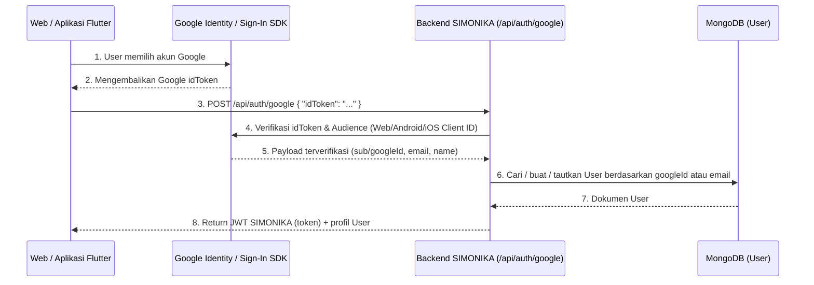

# Panduan Integrasi Google OAuth SIMONIKA (Web & Mobile Flutter)

Dokumen ini menjelaskan cara menyiapkan **Google OAuth** untuk backend Next.js SIMONIKA serta cara mengintegrasikannya ke aplikasi **Mobile Flutter** (Android & iOS) agar berbagi akun yang sama dengan Web Dashboard.

---

## 1. Arsitektur Autentikasi Google di SIMONIKA



Karena semua Client ID (Web, Android, iOS) dibuat dalam **1 Project Google Cloud yang sama**, nilai `sub` (`googleId`) dan `email` user dijamin sama. User yang login via Web maupun aplikasi Flutter otomatis masuk ke akun SIMONIKA yang sama.

---

## 2. Persiapan Kredensial di Google Cloud Console

1. Buka [Google Cloud Console](https://console.cloud.google.com/) dan pilih/buat 1 Project untuk SIMONIKA.
2. Buka **APIs & Services > OAuth consent screen**:
   - Pilih **External**, isi nama aplikasi (`SIMONIKA`), email support, dan simpan.
   - Jika status aplikasi masih *Testing*, daftarkan email yang akan digunakan uji coba pada bagian **Test users**.
3. Buka **APIs & Services > Credentials > + Create Credentials > OAuth client ID**, lalu buat Client ID berikut di dalam project yang sama:

### A. Web Application Client ID (Wajib untuk Web & `serverClientId` Flutter)
- **Application type:** `Web application`
- **Authorized JavaScript origins:**
  - `http://localhost:3000`
  - Domain produksi backend/web Anda (contoh: `https://simonika.id`)
- Simpan nilai Client ID-nya (misal: `111111-web.apps.googleusercontent.com`).

### B. Android Client ID (Wajib untuk Flutter Android)
- **Application type:** `Android`
- **Package name:** Sesuai `applicationId` di `android/app/build.gradle` project Flutter Anda (contoh: `com.simonika.mobile`).
- **SHA-1 certificate fingerprint:** Ambil SHA-1 debug dari project Flutter Anda dengan menjalankan perintah ini di folder `android/` project Flutter:
  ```bash
  cd android && ./gradlew signingReport
  ```
  *(Atau menggunakan keytool:* `keytool -list -v -keystore ~/.android/debug.keystore -alias androiddebugkey -storepass android -keypass android`*)*
- Simpan nilai Client ID-nya (misal: `222222-android.apps.googleusercontent.com`).

### C. iOS Client ID (Opsional, jika build ke iOS)
- **Application type:** `iOS`
- **Bundle ID:** Sesuai Bundle Identifier di Xcode / `ios/Runner.xcodeproj` (contoh: `com.simonika.mobile`).
- Simpan nilai Client ID-nya (misal: `333333-ios.apps.googleusercontent.com`) dan **iOS URL scheme** (`com.googleusercontent.apps.333333-ios`).

---

## 3. Konfigurasi `.env.local` di Backend SIMONIKA

Isi variabel berikut pada file `.env.local` di project backend ini:

```env
# Web Client ID (dipakai oleh tombol Google di Web & sebagai serverClientId di Flutter)
GOOGLE_CLIENT_ID=111111-web.apps.googleusercontent.com
NEXT_PUBLIC_GOOGLE_CLIENT_ID=111111-web.apps.googleusercontent.com

# Opsional: Client ID tambahan untuk Mobile Flutter
GOOGLE_ANDROID_CLIENT_ID=222222-android.apps.googleusercontent.com
GOOGLE_IOS_CLIENT_ID=333333-ios.apps.googleusercontent.com
```

> [!TIP]
> Endpoint [`/api/auth/google`](../pages/api/auth/google/index.ts) secara otomatis mengizinkan semua Client ID di atas (`GOOGLE_CLIENT_ID`, `NEXT_PUBLIC_GOOGLE_CLIENT_ID`, `GOOGLE_ANDROID_CLIENT_ID`, `GOOGLE_IOS_CLIENT_ID`, atau beberapa ID yang dipisahkan koma di `GOOGLE_CLIENT_IDS`).

---

## 4. Integrasi di Project Mobile Flutter

### Langkah 1: Tambahkan Dependency di `pubspec.yaml`

Jalankan perintah berikut di project Flutter Anda:

```bash
flutter pub add google_sign_in http shared_preferences
```

Atau pastikan `pubspec.yaml` memuat:

```yaml
dependencies:
  flutter:
    sdk: flutter
  google_sign_in: ^6.2.2
  http: ^1.2.2
  shared_preferences: ^2.3.2
```

### Langkah 2: Konfigurasi Platform (Android & iOS)

- **Android:**
  Tidak perlu menambahkan kode khusus di `AndroidManifest.xml`, cukup pastikan:
  1. `applicationId` di `android/app/build.gradle` sama persis dengan **Package name** di Google Cloud Console.
  2. SHA-1 fingerprint dari komputer Anda sudah terdaftar pada **Android OAuth Client ID** di Google Cloud Console.

- **iOS (`ios/Runner/Info.plist`):**
  Jika menargetkan iOS, tambahkan `GIDClientID` dan `CFBundleURLTypes` (reversed client ID) ke `ios/Runner/Info.plist`:
  ```xml
  <key>GIDClientID</key>
  <string>333333-ios.apps.googleusercontent.com</string>
  <key>CFBundleURLTypes</key>
  <array>
    <dict>
      <key>CFBundleTypeRole</key>
      <string>Editor</string>
      <key>CFBundleURLSchemes</key>
      <array>
        <!-- Kebalikan dari iOS Client ID -->
        <string>com.googleusercontent.apps.333333-ios</string>
      </array>
    </dict>
  </array>
  ```

### Langkah 3: Buat `AuthService` di Flutter (`lib/services/auth_service.dart`)

> [!IMPORTANT]
> Pada Android, agar `googleAuth.idToken` tidak bernilai `null`, Anda **wajib** mengisi parameter `serverClientId` dengan **Web Client ID** (`GOOGLE_CLIENT_ID` dari backend).

```dart
import 'dart:convert';
import 'package:google_sign_in/google_sign_in.dart';
import 'package:http/http.dart' as http;
import 'package:shared_preferences/shared_preferences.dart';

class SimonikaUser {
  final String id;
  final String name;
  final String username;
  final String? email;

  SimonikaUser({
    required this.id,
    required this.name,
    required this.username,
    this.email,
  });

  factory SimonikaUser.fromJson(Map<String, dynamic> json) {
    return SimonikaUser(
      id: json['id'] as String,
      name: json['name'] as String,
      username: json['username'] as String,
      email: json['email'] as String?,
    );
  }
}

class AuthService {
  /// Ganti dengan URL backend SIMONIKA Anda.
  /// Catatan: Gunakan http://10.0.2.2:3000 jika tes dari Android Emulator ke localhost laptop.
  static const String baseUrl = 'http://10.0.2.2:3000';

  /// Gunakan WEB CLIENT ID (sama dengan GOOGLE_CLIENT_ID di .env.local backend)
  static const String webClientId = '111111-web.apps.googleusercontent.com';

  final GoogleSignIn _googleSignIn = GoogleSignIn(
    scopes: ['email', 'profile'],
    serverClientId: webClientId,
  );

  /// Login dengan Google dan tukarkan idToken menjadi JWT SIMONIKA
  Future<SimonikaUser> signInWithGoogle() async {
    // 1. Buka dialog pemilihan akun Google di HP
    final GoogleSignInAccount? googleAccount = await _googleSignIn.signIn();
    if (googleAccount == null) {
      throw Exception('Login Google dibatalkan oleh pengguna');
    }

    // 2. Ambil idToken dari Google
    final GoogleSignInAuthentication googleAuth =
        await googleAccount.authentication;
    final String? idToken = googleAuth.idToken;

    if (idToken == null || idToken.isEmpty) {
      throw Exception(
        'Gagal mendapatkan Google ID Token. Pastikan serverClientId (Web Client ID) sudah benar.',
      );
    }

    // 3. Kirim idToken ke endpoint backend SIMONIKA
    final response = await http.post(
      Uri.parse('$baseUrl/api/auth/google'),
      headers: {'Content-Type': 'application/json'},
      body: jsonEncode({'idToken': idToken}),
    );

    final Map<String, dynamic> data = jsonDecode(response.body);

    if (response.statusCode != 200) {
      throw Exception(data['message'] ?? 'Login Google gagal di server');
    }

    final String? appJwtToken = data['token'] as String?;
    final Map<String, dynamic>? userJson =
        data['user'] as Map<String, dynamic>?;

    if (appJwtToken == null || userJson == null) {
      throw Exception('Respons login dari server tidak lengkap');
    }

    // 4. Simpan JWT SIMONIKA di penyimpanan lokal HP
    final prefs = await SharedPreferences.getInstance();
    await prefs.setString('token', appJwtToken);
    await prefs.setString('user', jsonEncode(userJson));

    return SimonikaUser.fromJson(userJson);
  }

  /// Ambil JWT Token untuk dikirim ke endpoint terproteksi (misal /api/pool/read)
  Future<String?> getToken() async {
    final prefs = await SharedPreferences.getInstance();
    return prefs.getString('token');
  }

  /// Contoh memanggil endpoint profil /api/auth/profile menggunakan JWT
  Future<SimonikaUser> fetchProfile() async {
    final token = await getToken();
    if (token == null) {
      throw Exception('Belum login');
    }

    final response = await http.get(
      Uri.parse('$baseUrl/api/auth/profile'),
      headers: {
        'Content-Type': 'application/json',
        'Authorization': 'Bearer $token',
      },
    );

    final Map<String, dynamic> data = jsonDecode(response.body);
    if (response.statusCode != 200) {
      throw Exception(data['message'] ?? 'Gagal memuat profil');
    }

    return SimonikaUser.fromJson(data['user'] as Map<String, dynamic>);
  }

  /// Logout dari SIMONIKA & Google
  Future<void> signOut() async {
    final prefs = await SharedPreferences.getInstance();
    await prefs.remove('token');
    await prefs.remove('user');
    await _googleSignIn.signOut();
  }
}
```

### Langkah 4: Contoh Pemakaian pada Tombol UI Flutter

```dart
ElevatedButton.icon(
  icon: const Icon(Icons.login),
  label: const Text('Masuk dengan Google'),
  onPressed: () async {
    try {
      final authService = AuthService();
      final user = await authService.signInWithGoogle();
      // Navigasi ke halaman Dashboard Kolam di Flutter
      debugPrint('Berhasil login sebagai: ${user.name} (@${user.username})');
    } catch (e) {
      ScaffoldMessenger.of(context).showSnackBar(
        SnackBar(content: Text(e.toString())),
      );
    }
  },
)
```

---

## 5. Spesifikasi Endpoint API `/api/auth/google`

- **URL:** `POST /api/auth/google`
- **Headers:** `Content-Type: application/json`
- **Request Body:**
  ```json
  {
    "idToken": "<google-id-token>"
  }
  ```
- **Response Sukses (`200 OK`):**
  ```json
  {
    "message": "Login Google berhasil",
    "token": "<jwt-token-simonika-berlaku-7-hari>",
    "user": {
      "id": "665f1a2b3c4d5e6f7a8b9c0d",
      "name": "Budi Santoso",
      "username": "budi_santoso",
      "email": "budi@gmail.com",
      "createdAt": "2026-10-19T00:00:00.000Z",
      "updatedAt": "2026-10-19T00:00:00.000Z"
    }
  }
  ```
- **Cara Mengakses Endpoint Lain Setelah Login:**
  Sertakan `token` di header `Authorization` pada setiap request berikutnya (sama seperti login username/password):
  ```http
  Authorization: Bearer <jwt-token-simonika>
  ```

---

## 6. Troubleshooting Umum di Flutter

| Masalah / Error | Penyebab | Solusi |
| :--- | :--- | :--- |
| `PlatformException(sign_in_failed, com.google.android.gms.common.api.ApiException: 10)` | SHA-1 debug/release atau Package Name Android belum cocok di Google Cloud Console. | Jalankan `cd android && ./gradlew signingReport`, salin `SHA1` dari variant `debug`, lalu daftarkan pada **Android OAuth Client ID** di Google Cloud Console. |
| `googleAuth.idToken` bernilai `null` | Parameter `serverClientId` belum diisi atau diisi dengan Android Client ID. | Isi `serverClientId` di `GoogleSignIn(serverClientId: ...)` menggunakan **Web Application Client ID** (`GOOGLE_CLIENT_ID`). |
| `Connection refused` saat tes di Android Emulator | Menggunakan `http://localhost:3000` dari dalam emulator. | Gunakan `http://10.0.2.2:3000` untuk Android Emulator, atau IP LAN laptop (misal `http://192.168.1.x:3000`) jika tes di HP fisik. |
